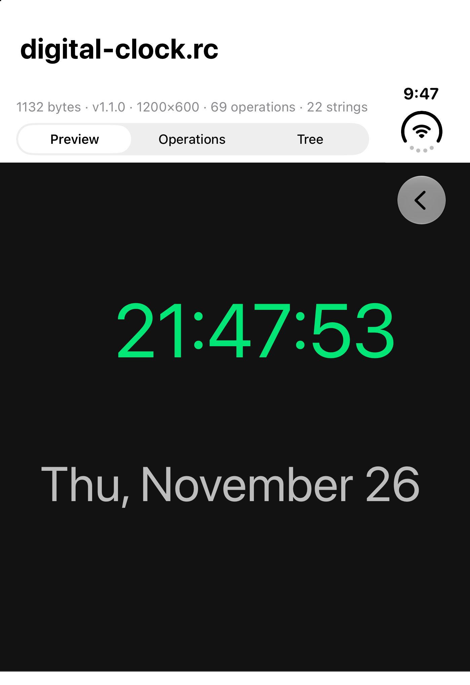

# RemoteComposeUI

**Render AndroidX Remote Compose documents in SwiftUI.**

RemoteComposeUI is a Swift package that reads Remote Compose document data (`.rc`) and renders the supported UI operations as SwiftUI views. It is designed for Apple-platform applications that want to consume a Remote Compose document without embedding the Android rendering stack.

The idea is to separate the description of a UI from the platform that displays it:

- **Create** a Remote Compose document with the official Remote Compose library.
- **Transfer** the serialized document to an Apple-platform app like iOS or Mac.
- **Render** supported content using SwiftUI through `RemoteComposeView`.

## Why RemoteComposeUI?

Remote Compose provides a document-oriented representation of UI. RemoteComposeUI explores how that representation can be consumed by SwiftUI, so an iOS or macOS application can render supported document content using Apple's UI framework.

The renderer uses SwiftUI views and layout primitives rather than trying to run Android Compose on Apple platforms.

[](https://github.com/deanalvero/RemoteComposeUI/tree/main/Examples/RemoteComposeUIDemo)

## Quick start

The Swift package exposes the library product `RemoteComposeUI` and the `rcdump` inspection executable.

### Add the package dependency

In Xcode:

1. Select **File → Add Package Dependencies…**
2. Enter the repository URL:

   `https://github.com/deanalvero/RemoteComposeUI`

3. Select the `main` branch as the dependency rule.
4. Add the `RemoteComposeUI` package product to your app target.

Or add the dependency directly to your `Package.swift`:

```swift
dependencies: [
    .package(
        url: "https://github.com/deanalvero/RemoteComposeUI.git",
        branch: "main"
    )
]
```

Then add the library product to your target:

```swift
.target(
    name: "YourApp",
    dependencies: [
        .product(
            name: "RemoteComposeUI",
            package: "remotecomposeui"
        )
    ]
)
```

**Warning:** The repository does not have version tags yet. Using the `main` branch tracks its latest changes, which may introduce API changes. For reproducible builds, pin a specific commit until versioned releases are available.


### Render an existing document

```swift
import SwiftUI
import RemoteComposeUI

struct RemoteDocumentScreen: View {
    let documentData: Data

    var body: some View {
        RemoteComposeView(data: documentData)
    }
}
```

`RemoteComposeView(data:)` parses the input leniently. For applications that want to validate the document before rendering, parse it explicitly:

```swift
import SwiftUI
import RemoteComposeUI

struct RemoteDocumentScreen: View {
    let document: RemoteDocument

    var body: some View {
        RemoteComposeView(document: document)
    }
}

func loadDocument(from data: Data) throws -> RemoteDocument {
    try RemoteDocument.parse(data)
}
```

## Inspect a document

The `rcdump` executable reads a `.rc` file and prints its decoded header, operations, and layout tree. It also reports parser diagnostics and the byte location of a decoding failure when available.

```bash
swift run rcdump path/to/document.rc
```

## Notes

More operations will be added over time. Enjoy!
